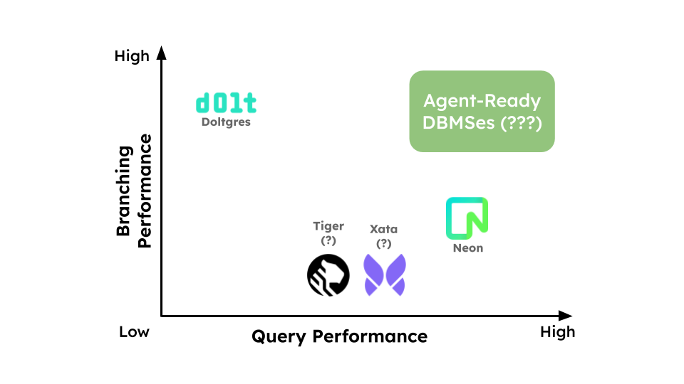

# BranchBench：面向 Agent 数据库的分支性能

!!!info "论文信息"
    - 标题：BranchBench: Aligning Database Branching with Agentic Demands
    - 作者：Elaine Ang, Sam Weldon, In Keun Kim, Kevin Durand, Kostis Kaffes, Eugene Wu
    - 来源：arXiv
    - 链接：[论文链接](https://arxiv.org/abs/2604.17180)，[仓库链接](https://github.com/ElaineAng/db-fork)

针对 agent 的工作特性，文章设计了一套与数据库分支功能相关的性能测试，并把业内的现有解决方案进行实测，得出了并不乐观的结果。

## 背景

Agent 被广泛应用，其工作效率变得至关重要。Agent 在很多场景（软件开发、数据分析等）下会对其所操作的数据库进行同一基线数据下的多种分支操作，并对不同的结果进行比较和修改等处理。例如，一个编码 Agent 可能尝试几种数据库迁移或回填方案；一个数据清理 Agent 可能对同一批异常值尝试多种修复策略；一个 MCTS 搜索 Agent 则会从某个状态派生许多后续状态，评估得分，再决定保留哪些路径。作者把这种模式称为 **Agentic Speculative Branching**，并将 branch 定义为：从父状态派生、具有名称、相互隔离、可以独立修改的数据库状态，且系统应尽可能共享分支间未变化的数据。

因此，支持版本控制与分支管理的数据库在现在的场景下就能够更高效地完成上述任务。然而，传统数据库 benchmark 通常假设数据库只有一个不断前进的状态，不衡量分支创建、切换、树形扩展、跨分支比较和分支删除后的回收成本。嵌套事务或 savepoint 可以回滚单条执行路径，但缺少持久化的命名分支、分支谱系和并行存在的备选状态；物理设计变更也不容易作为独立的假设状态长期保存。

于是作者提出 BranchBench，用来评估关系数据库面对“分支—修改—评估”工作负载时的能力。

## 五种工作负载

### 软件工程

Agentic Software Engineering(ASE)。典型过程为：修改应用所需的数据库 schema，执行回填，再跑测试；测试不通过就从较早状态另开分支重试，通过后合并选中的结果。论文例子是为客户表添加 loyalty tier，调整阈值后重跑测试。

主要是中等深度、分叉的树。这里需要隔离多个开发尝试，混合 DDL、回填和读密集测试。

### 故障复现

Failure Reproduction。从事务日志的某个前缀开始重放，检查故障是否出现；缩小前缀范围，直到定位触发事务。论文例子通过反复二分定位到第 372 个事务。

主要是浅层、宽扇出，每次分支偏短、通常立即丢弃；强调重放吞吐与快速创建/删除。

### 数据清洗

Data Curation。针对异常尝试多种清理策略或参数，分别做验证，再跨分支比较结果并选择方案。

主要是宽而浅的树；以扫描、数据清理和跨分支质量指标比较为主。

### MCTS

Monte Carlo Tree Search。选择有潜力的叶子，扩展一个动作，再模拟后续路径、执行奖励查询，并将结果反馈给搜索策略。

主要是深而窄的树；树深和反复访问历史状态带来压力。每次修改可以很小，但查询可能需要较重的分析计算。

### 模拟

Monte Carlo Simulation。从同一初始状态派生许多独立试验，在每个分支运行一系列随机情景，再聚合结果。

主要是非常宽、深度为 1 的星状树；大量分支、每个分支内部有较多写入，结束时需汇总并回收。

以上五种场景不仅代表五类应用，也是在给系统施加五种不同“几何形状”的压力。星状树测批量 fork；深链测谱系读取或状态重建；宽浅树测大量并发分支的资源管理；带 DDL 的场景则能暴露数据引擎是否能有效共享 schema 变化带来的状态。

## 对数据库架构分类

论文把各个数据库架构按照【分支功能实现在哪一层】进行分类。层次越靠近底层，系统越像黑箱，通常更容易复用现有数据库，但对关系和 SQL 语义了解较少；越靠近数据库内部，越能利用数据结构做精细共享，但引擎改造和版本管理复杂度更高。

| 层次与机制 | 代表系统 | 分支如何实现 | 主要权衡 |
|---|---|---|---|
| **存储基底：块级 CoW** | Tiger Data、Xata、Vela、PG file copy | 数据库之下，以存储块或文件系统快照共享数据；数据库可基本不改造。Xata 使用块级 CoW；PostgreSQL 文件克隆依赖支持 CoW 的文件系统。 | 部署/兼容路径相对直接，但块边界可能与数据库页不一致，产生写放大。实例连接、协调和克隆约束也可能成为控制面开销。 |
| **恢复管理器：WAL 时间线** | Neon | 多条时间线共享共同 WAL 前缀，分叉后各自记录日志；按需重建分支页面。 | 分支不必复制全量数据，且每个分支可获得独立计算资源；代价是创建/连接和冷读的重建、网络与实例 provisioning 开销。历史 WAL 还必须保留到依赖它的分支不再需要。 |
| **存储管理器：页级 CoW** | Minuet（研究系统） | 分支共享页图；修改某页时复制该页并更新分支根指针。 | 粒度与数据库页、缓冲池更吻合；但版本页图的内存开销和垃圾回收成本可能较高，论文称 Minuet 尚未达到生产就绪状态。 |
| **存储管理器：内容寻址树** | Dolt | 数据组织为 content-addressed Prolly tree；branch 是一个树根指针，更新时复制、重算受影响路径上的节点。 | branch、diff、merge 可自然利用树结构及结构共享；查询要遍历树结构，树和修改历史累积时可能变慢；历史保存也影响存储。 |
| **事务/逻辑层** | 事务/savepoint；ServiceWeaver（研究方案） | 事务和 savepoint 通过回滚模拟局部探索；逻辑层方案可用视图或插入/删除集合描述版本。 | 事务回滚适合有限、串行的探索，却不是持久化分支树；ServiceWeaver 面向两个版本间的差分测试，不等于支持任意分支树和物理修改。 |

### 为什么嵌套事务不行？

普通嵌套事务不足以满足 Agent 探索，原因不只是“回滚慢”：长事务可能保留 MVCC 历史、延迟 GC；savepoint 不是持久化命名分支；多个备选分支并存和 merge 缺乏清晰语义；索引或物化视图等物理状态也不自然地成为独立假设。

## 实验设计

### 实验对象

系统包括 Neon、Dolt、Tiger Data、Xata，以及 PostgreSQL 文件克隆和事务/savepoint 基线。

实验基准包含了两种配置：

- **Full**：scale factor \(W=5\)，使用表 3 的目标工作负载参数，观察系统在较完整压力下的能力。
- **Mini**：\(W=1\)，减少 worker 和步骤数量，但保留每步操作混合；用于观察功能/正确性缺口及操作成本。

由于绝大多数系统未完成 Full，作者在关键性能分析中主要比较 Neon 与 Dolt，且部分图表采用 Mini 配置。

### 实验基准设计

采用了 CH-benCHmark，结合 TPC-C 的事务表和 TPC-H 的分析表，场景**同时包含事务性修改和分析性查询**。每个 worker 在共享的分支树上执行指定的步骤，包含：

- 创建、连接分支
- schema/data 修改
- 读查询评估
- 按照概率删除分支

此外，还有跨分支查询从当前 frontier 读取的候选结果。

### 实验指标

1. 端到端工作流时间
2. 分支管理开销比例
3. 存储效率
4. 单操作延迟

## 实验结果

**1. 分支创建和连接**

Xata 和 Tiger 的创建延迟比其他系统高出多个数量级，因此作者排除它们后续的完整性能比较。Neon 创建和连接分支也显著慢于 Dolt；作者将其归因于为新分支配置计算实例、控制面网络延迟等因素。PostgreSQL 事务创建成本最低，但它不能代表具备持久独立分支能力的系统。

**2. 没有系统完成全部 Full 工作负载**

每个工作流的运行上限是两小时。表 4 表明，没有一个系统完整完成五类 Full 配置。但是这些结果证明的是本文测试条件下的可运行性与瓶颈，不能单独推出这些服务在所有版本、配置或企业合同下都不能扩展。

**3. 存储开销**

软件开发中 Dolt 约 93.1 MB，Neon 约 4.0 GB；数据清理中 Dolt 约 94.1 MB，Neon 约 4.7 MB。作者认为软件开发里的大量 schema 回填可能导致 Neon 与 Dolt 的共享和物化表现差异；Dolt 的故障复现开销较高，与被删分支的历史仍被保存有关；数据清理中，`DEFAULT FALSE` 在 PostgreSQL 中可以是 metadata-only 操作，而 Dolt 会物化现有行的默认值。

**4. Neon 与 Dolt**

快分支和快查询的取舍.

- Dolt 的 branch 操作快，但在分支数和修改累积后，读查询可能成为瓶颈。模拟场景中有大量分支且每步 50 个 mutation，范围查询尤其慢。
- Neon 的读操作总体更快，但创建/连接分支受 API 往返和计算实例配置延迟影响。
- DDL 也存在明显差异：数据清理中的 `DEFAULT` 列添加在 Dolt 上需要对既有行物化，PostgreSQL 可作为 metadata-only 操作处理。

Dolt 读延迟相对 Neon 高约 2–4000 倍（按具体工作负载与查询而异），范围读取最突出；摘要给出的深分支总体范围是 5–4000 倍。

**5. 读扩展性**

微基准使用 \(W=1\) 的 CH-benCHmark 数据，比较单点查询和连续 100 键的范围查询。Dolt 的点读优于 Neon，论文解释为 Dolt 在本机执行，而 Neon 承担云服务的网络往返。范围读取则相反：Dolt 的 Prolly tree 遍历成本使其在不同配置中比 Neon 慢 2–4000 倍。

作者由此给出的定性判断是：Neon 用更高的每分支资源和启动成本换来并行查询能力；Dolt 以较低的分支成本换来单机内共享资源、并发读扩展受限。轻量点查、分支密集的工作负载可能更适合后者；昂贵范围查询且需要并行计算的工作负载，可能更能摊销前者的启动成本。